<div align="center">

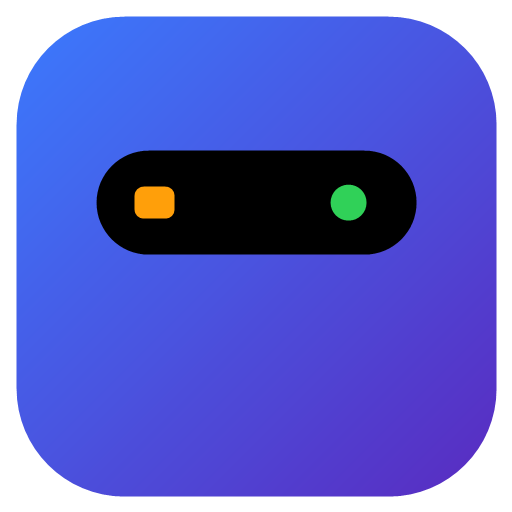

# Dynamic Island for Windows

**A free, Mac-style island at the top-centre of your screen.**<br>
Music, timers, alarms, Claude Code approvals, system pop-ups and quick tools, right where you look.

[](https://github.com/Vraj93/dynamic-island-windows/releases/latest)


<br>

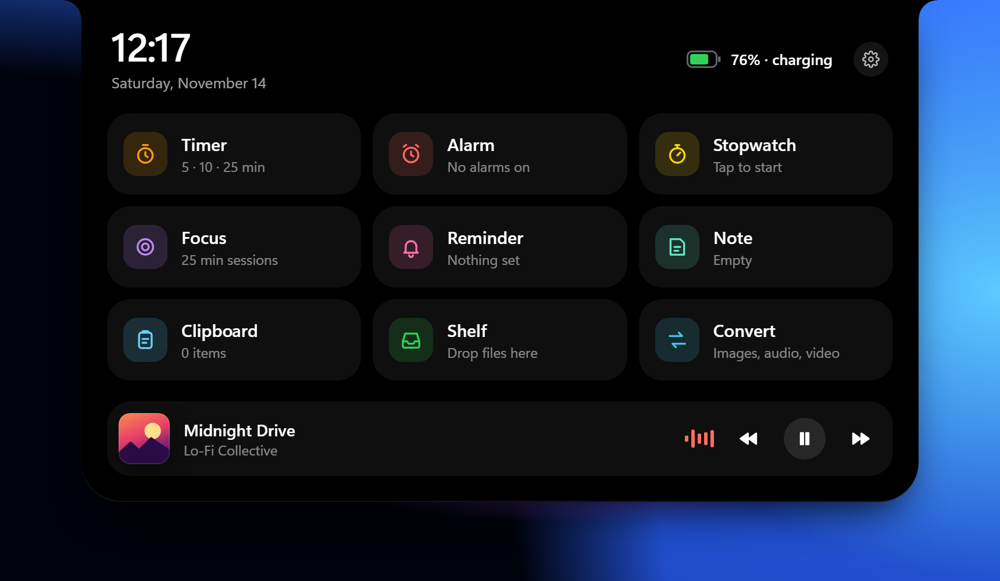

<sub>Rest the mouse on the top edge and the utility sheet drops down.</sub>

</div>

<br>

## How it works

Nothing sits on your screen while you're idle. Push the mouse to the **top-centre edge** and the utility sheet slides
down. When something happens (a song starts, a timer runs, Claude Code needs you) a small island appears on its own,
and grows into a full panel when you click it. Clicks pass straight through everywhere except the island, and it never
steals your keyboard.

## Music and video

<table>
<tr>
<td width="50%">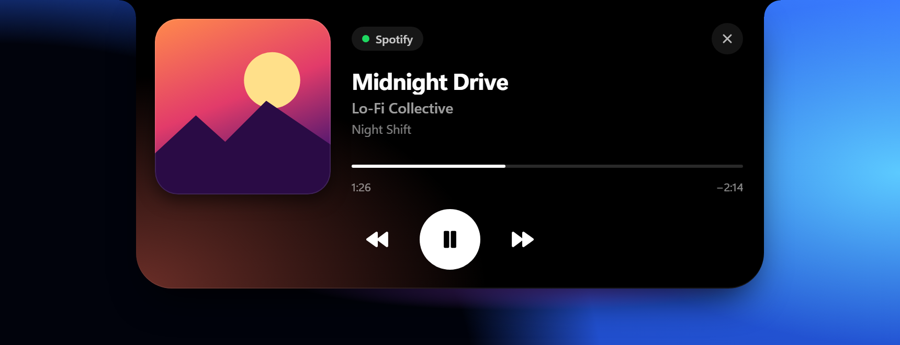</td>
<td width="50%"><br><br>
<b>Anything Windows knows is playing</b>: Spotify, YouTube in a browser, VLC and more.<br><br>
Real cover art, sound bars that move with the actual audio, play / pause / next / previous, drag to seek, and
switching between apps. A timer gets its own small island next to the music. Right-click to hide.</td>
</tr>
</table>

## Claude Code, right in the island

<table>
<tr>
<td width="50%">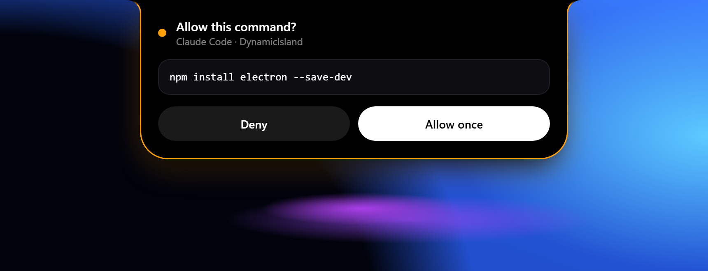</td>
<td width="50%">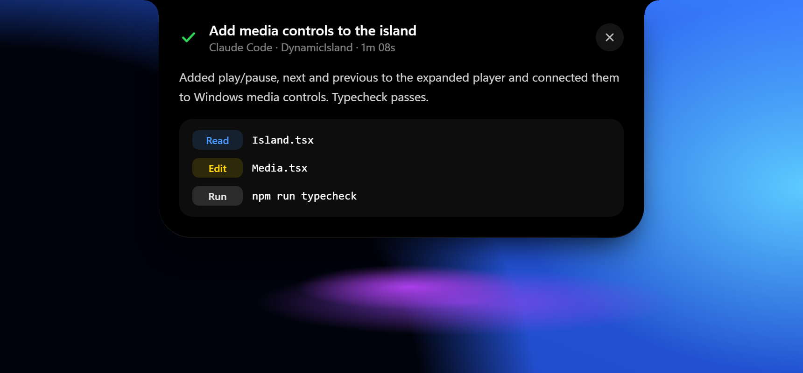</td>
</tr>
<tr>
<td><b>Allow or Deny</b> commands without hunting for the terminal window.</td>
<td><b>Know when it's done</b>, with the final answer and every file it read, edited or ran.</td>
</tr>
</table>


## Timers, alarms and focus

<table>
<tr>
<td width="33%">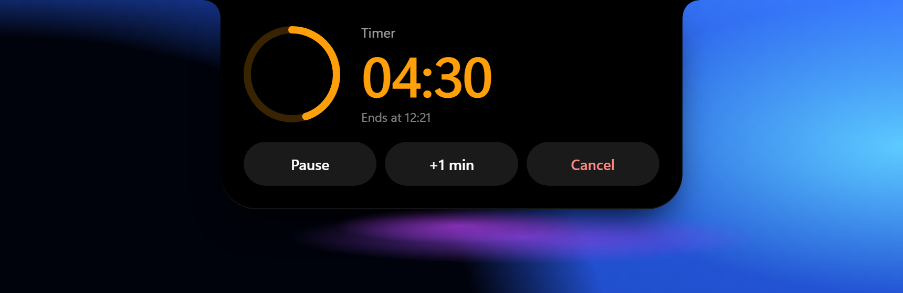</td>
<td width="33%"></td>
<td width="33%"></td>
</tr>
<tr>
<td><b>Timer</b> with presets, pause and +1 min.</td>
<td><b>Focus</b>: Pomodoro sessions with breaks.</td>
<td><b>Alarms</b> for weekdays, weekends or once.</td>
</tr>
<tr>
<td></td>
<td>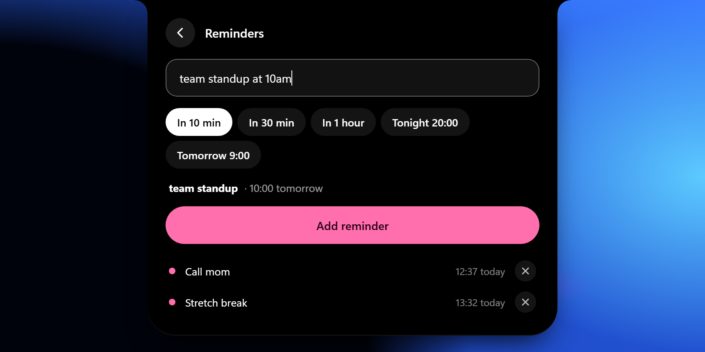</td>
<td></td>
</tr>
<tr>
<td><b>Alerts</b> glow and chime until you stop them.</td>
<td><b>Reminders</b> in plain words: "call mom in 20 min".</td>
<td><b>System pop-ups</b> replace Windows' own volume pop-up.</td>
</tr>
</table>

## Files: shelf and converter

<table>
<tr>
<td width="33%">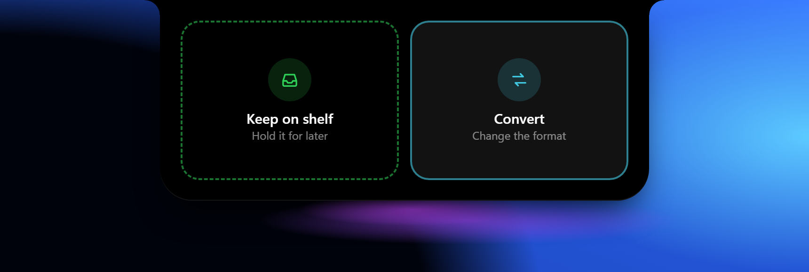</td>
<td width="33%">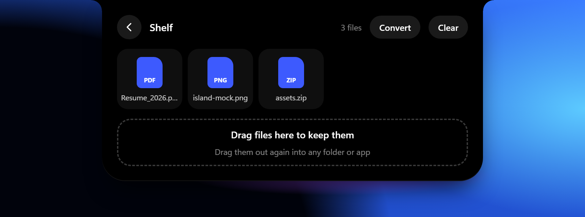</td>
<td width="33%">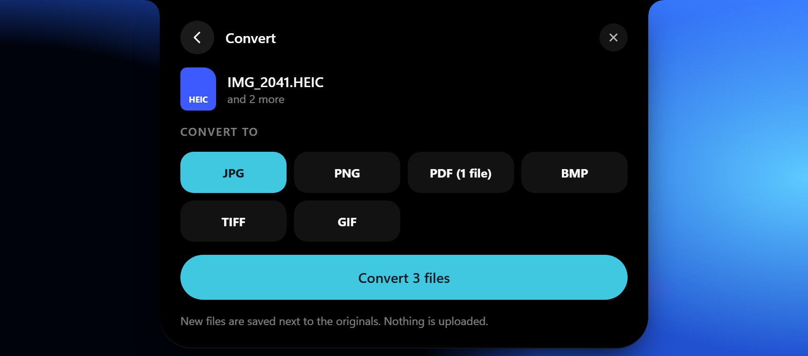</td>
</tr>
<tr>
<td><b>Drag files to the top</b>: keep them or convert them.</td>
<td><b>Shelf</b> holds files until you drag them out.</td>
<td><b>Convert</b> images, audio and video, all on your PC.</td>
</tr>
</table>

Also: **clipboard history**, a **quick note**, and a **stopwatch**.

## Settings

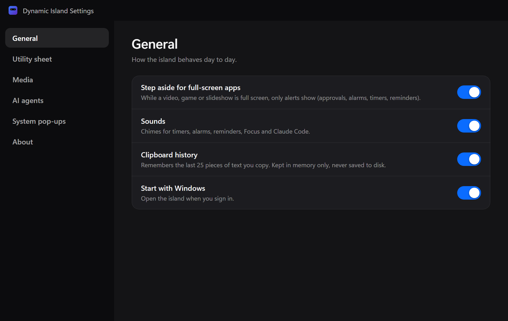

Every feature can be switched off. Settings opens from the gear in the sheet or from the tray icon.

<br>

## Install

**[Download the latest installer](https://github.com/Vraj93/dynamic-island-windows/releases/latest)**
(`Dynamic-Island-Setup-<version>.exe`) and run it. The setup wizard shows the license, lets you pick the folder, and adds
Start menu and desktop shortcuts. Uninstall from Windows Settings › Apps.

> [!NOTE]
> The installer isn't code-signed yet. **SmartScreen** may say "Windows protected your PC": click **More info** ›
> **Run anyway**. If **Smart App Control** is on, Windows blocks unsigned apps completely; use
> [Run from source](#run-from-source) instead, or wait for the Microsoft Store version.

### Run from source

Needs Windows 10/11 and [Node.js](https://nodejs.org). Works with Smart App Control on.

```bash
npm install
npm start
```

Quit from the tray icon near the clock. Turn on **Start with Windows** in Settings.

### Connect Claude Code (optional)

```bash
npm run connect-claude
```

Adds small hooks to `~/.claude/settings.json` (a backup is made first); undo with `npm run disconnect-claude`, or use
Settings › AI agents. If the island isn't running, or you don't answer within 55 seconds, Claude Code shows its normal
prompt.

<br>

## Design mockups

The design the app was built from. Click a board to see it full size.

<details>
<summary><b>Show all 8 mockup boards</b></summary>
<br>

| | |
|:-:|:-:|
| [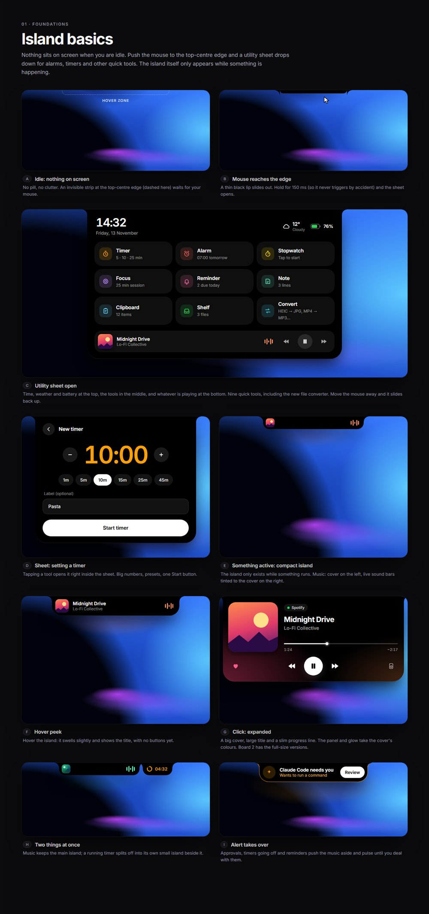](docs/mockups/1-basics.jpg)<br>**Island basics** | [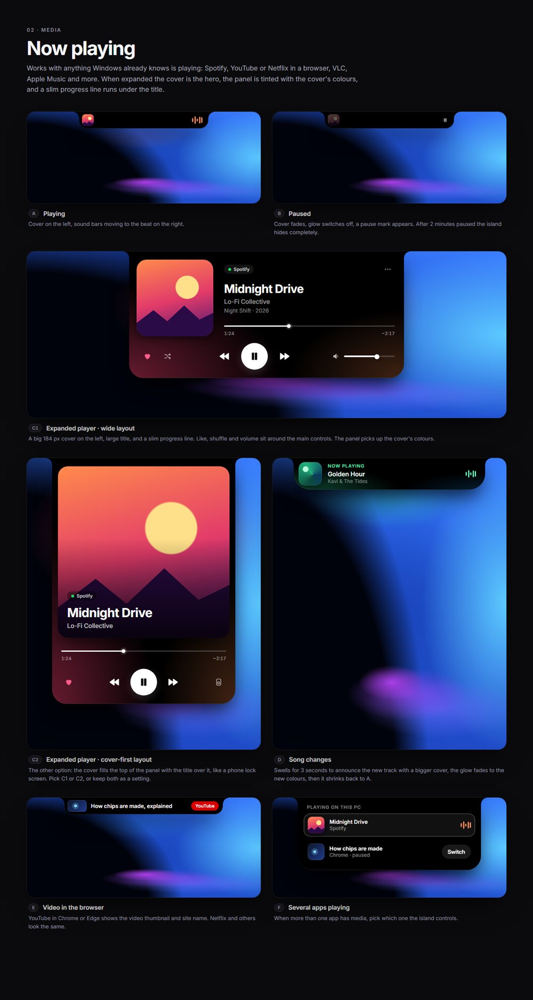](docs/mockups/2-media.jpg)<br>**Media** |
| [](docs/mockups/3-agents.jpg)<br>**AI agents** | [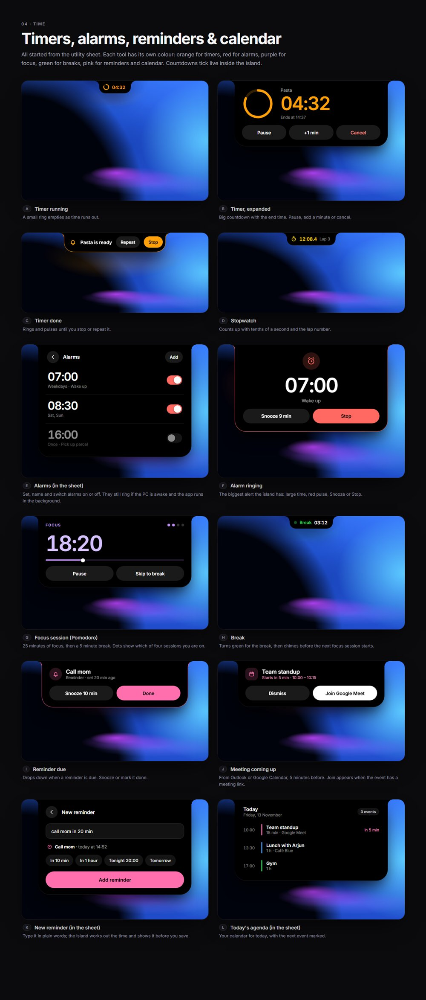](docs/mockups/4-timers.jpg)<br>**Timers, alarms, reminders** |
| [](docs/mockups/5-system.jpg)<br>**System pop-ups** | [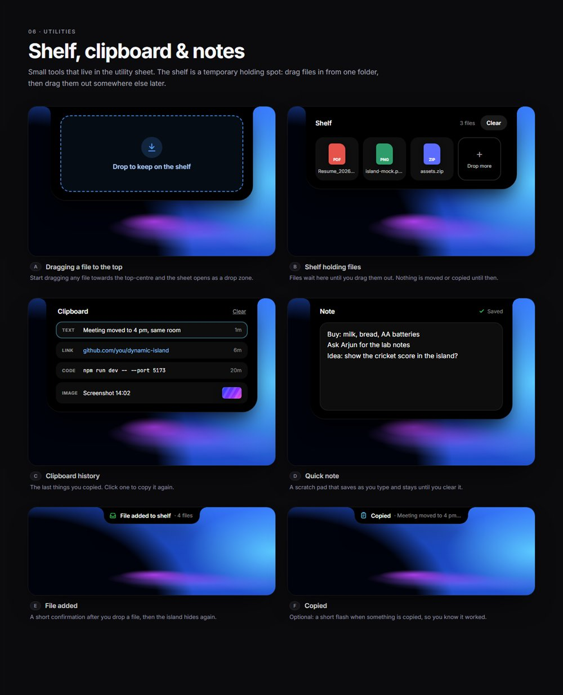](docs/mockups/6-utilities.jpg)<br>**Shelf, clipboard, notes** |
| [](docs/mockups/7-settings.jpg)<br>**Settings** | [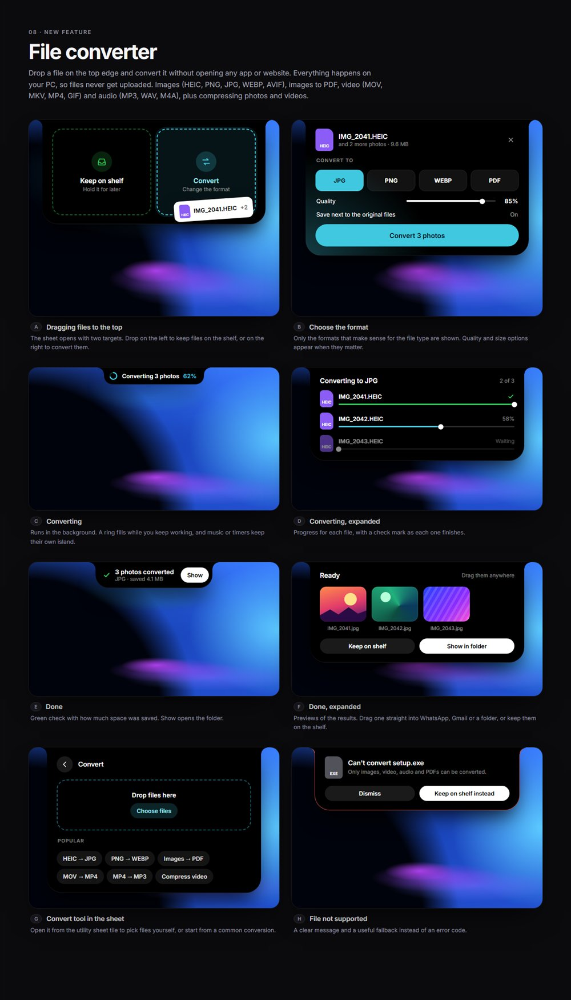](docs/mockups/8-convert.jpg)<br>**File converter** |

</details>

<br>

## For developers

<details>
<summary><b>How it's built</b></summary>
<br>

- `electron/main.js`: the see-through, always-on-top window, top-edge trigger, click-through, tray, Settings window,
  clipboard, shelf drag-out, the local server that Claude Code hooks talk to, and the converter.
- `electron/media.ps1`: a Windows PowerShell helper for what Electron can't reach: now playing (Windows media controls),
  full-screen detection, volume and volume keys (Core Audio), brightness, Caps Lock.
- `electron/convert.ps1`: file conversion with Windows' own components: Windows Imaging for pictures, Media Foundation
  for audio and video. PDFs come from Electron.
- `electron/hooks/claude-hook.js` and `scripts/claude-hooks.js`: the Claude Code hook and its installer.
- `ui/`: the island itself in plain HTML, CSS and JavaScript. `app.js` (island, media, agents, pop-ups), `tools.js`
  (sheet tools), `settings.*` (Settings window), `demo.js` (sample screens for these screenshots).

**Why PowerShell instead of native code:** Windows Smart App Control blocks unsigned programs compiled on the PC.
Electron and Windows PowerShell are trusted, so all Windows integration goes through PowerShell, which can still call
Windows APIs. No ffmpeg either; the converter only uses what ships with Windows.

</details>

<details>
<summary><b>Build the installer and screenshots</b></summary>
<br>

GitHub builds the installer: push a version tag and the [Build installer](.github/workflows/release.yml) workflow
creates a release with it attached.

```bash
git tag v0.1.1
git push origin v0.1.1
```

On a PC without Smart App Control you can also build locally with `npm run dist` (output in `dist/`). For the
Microsoft Store, fill in the `appx` identity in `package.json` from Partner Center and run `npm run dist:store`.

Screenshots in `docs/images` come from `scripts/screenshots.ps1` (renders the demo screens with Edge); the tray icon
from `scripts/make-icons.ps1`.

</details>

## Limits

- HEIC pictures need the free "HEIF Image Extensions" from the Microsoft Store; WEBP and HEIC can't be written.
- Brightness only works for a laptop's built-in screen.
- Not built yet: Windows notifications in the island, calendar, Bluetooth / Wi-Fi pop-ups.

## License

[MIT](LICENSE): free to use, change and share, including commercially, as long as the copyright notice stays.
