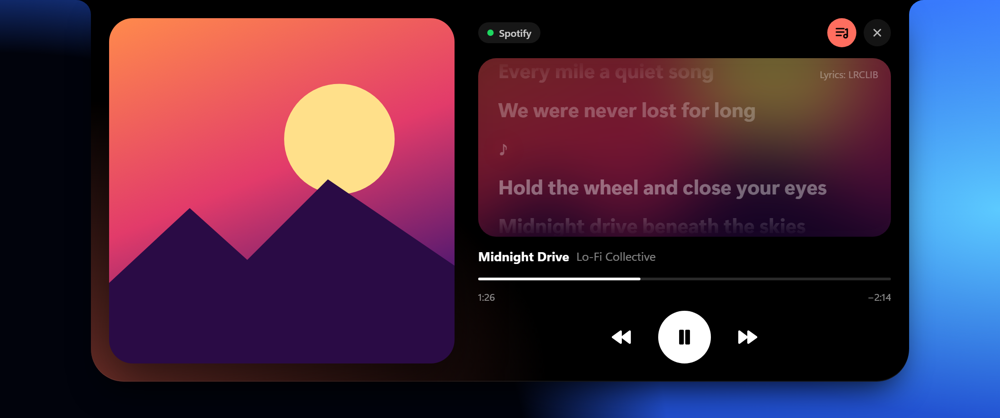
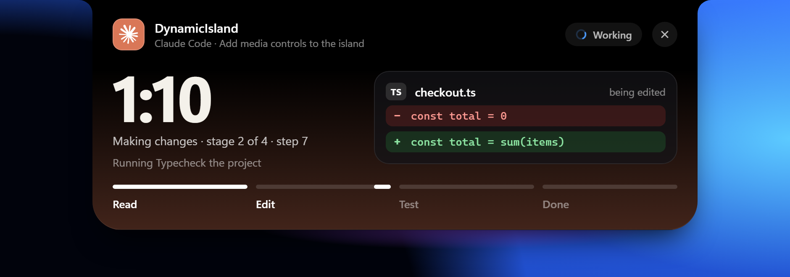
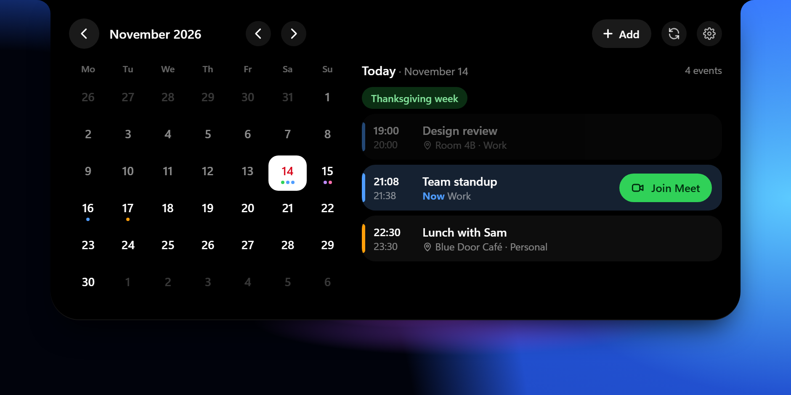
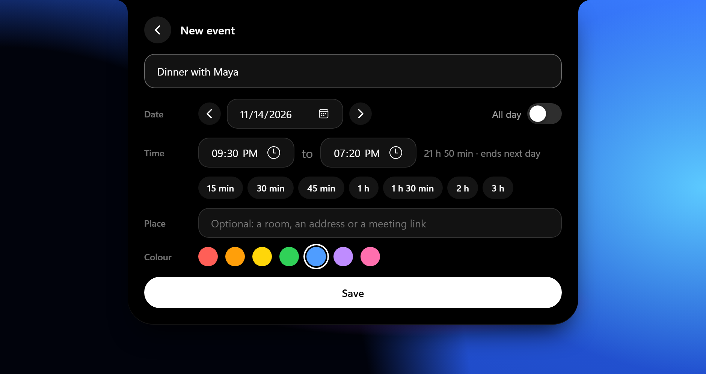
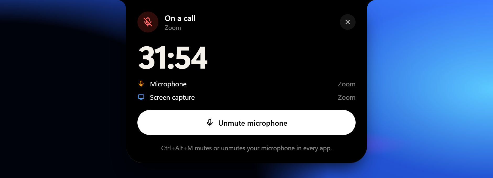
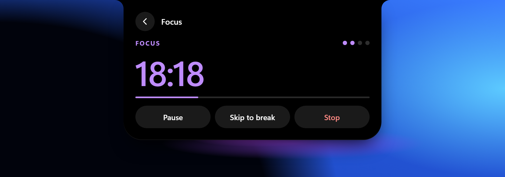
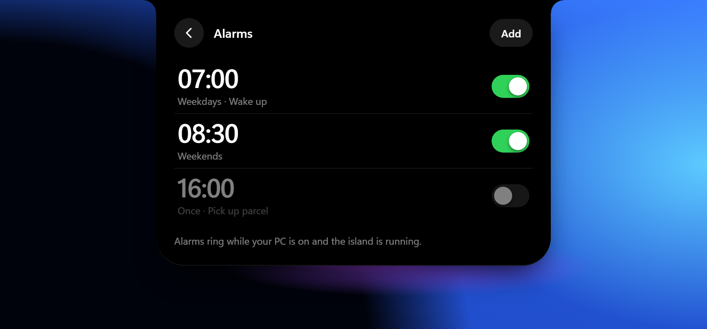
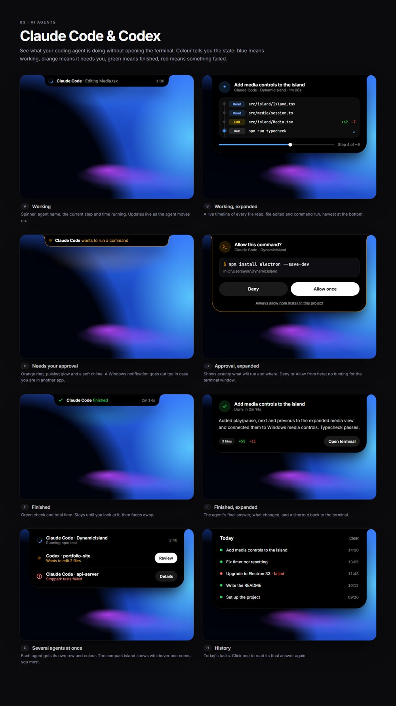
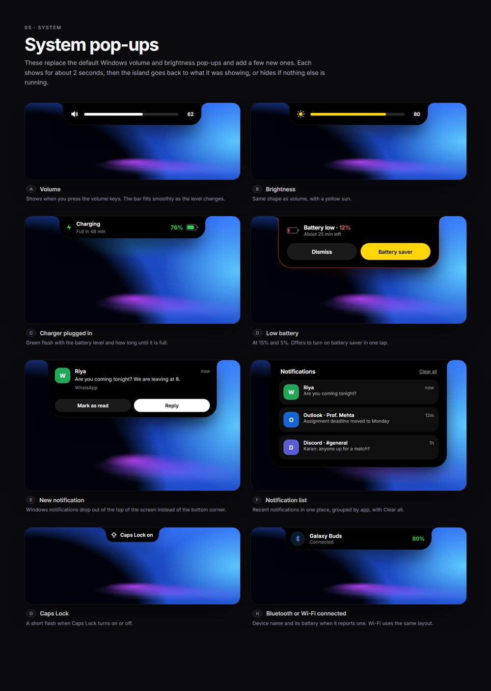
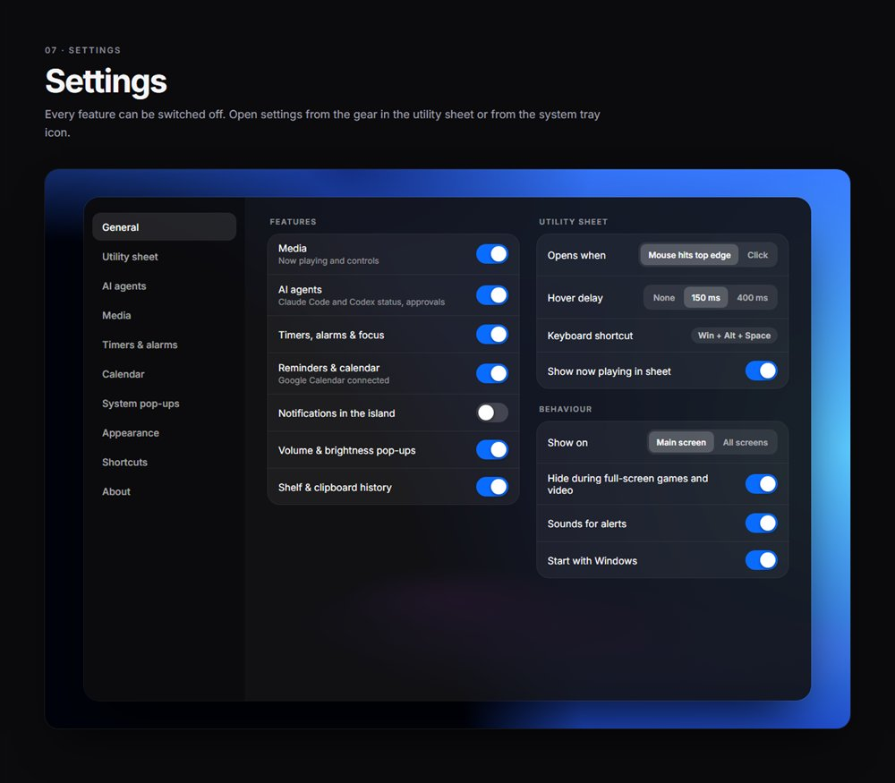

<div align="center">


# Dynamic Island for Windows

**A free, Mac-style island at the top-centre of your screen.**<br>
Music, calendar, timers, alarms, AI agent approvals, system pop-ups and quick tools, right where you look.

[](https://github.com/Vraj93/dynamic-island-windows/releases/latest)


<br>


<sub>Rest the mouse on the top edge and the utility sheet drops down.</sub>

</div>

<br>

## How it works

Nothing sits on your screen while you're idle. Push the mouse to the **top-centre edge** and the utility sheet slides
down. When something happens (a song starts, a timer runs, an AI agent needs you) a small island appears on its own,
and grows into a full panel when you click it. Clicks pass straight through everywhere except the island, and it never
steals your keyboard.

## Music and video



**Anything Windows knows is playing**: Spotify, Apple Music or YouTube in a browser, and more. A big cover, sound bars
that move with the actual audio, drag to seek, switching between apps, and **lyrics that scroll with the song**
(from LRCLIB, with lyrics.ovh and your own Musixmatch key as backups). When a site sends no cover, the island finds it
(iTunes, Deezer, MusicBrainz) or shows the service's logo: Netflix, Prime Video, Twitch... VLC shows what it's playing.

<table>
<tr>
<td width="50%"></td>
<td width="50%"></td>
</tr>
<tr>
<td><b>Two things at once</b>: a timer gets its own small island next to the music.</td>
<td>While an agent works, the music moves to the small island.</td>
</tr>
</table>

## AI agents, right in the island



Coding agents installed on your PC connect from Settings › AI agents in one click, no Node.js needed.
The panel shows how long it's been working, the code change it's making right now, and how far along it is.

<table>
<tr>
<td width="50%"></td>
<td width="50%"></td>
</tr>
<tr>
<td><b>Allow or Deny</b> commands without hunting for the terminal window.</td>
<td><b>Know when it's done</b>, with the final answer and every file it read, edited or ran.</td>
</tr>
</table>


### Any other agent, script or build tool

Anything that can run a command can show itself in the island, with no setup:

```bash
"Dynamic Island.exe" --island --name "Nightly build" --event start --text "Build and test"
"Dynamic Island.exe" --island --name "Nightly build" --event step  --text "Compiling 214 files"
"Dynamic Island.exe" --island --name "Nightly build" --event done  --text "All 512 tests passed"
```

`--event` is `start`, `step`, `needs-you`, `done`, `error` or `end`. Calls with the same `--name` (or `--id`) update one
island; `--color "#ff9f0a"` sets its colour. Settings › AI agents has these with the full path, ready to copy.

## Calendar

Works on its own: add events right in the island and they stay on your PC. Optionally sign in with **Google** or **Microsoft** (Outlook.com, Hotmail, Microsoft 365), or paste any **calendar link** (.ics / webcal).
Your week shows in the sheet, and a heads-up drops down a few minutes before each event, with a **Join** button for
Meet, Teams and Zoom. Reminders can sync both ways with **Google Tasks** or **Microsoft To Do**, so they reach your phone.
Sign-in happens in your own browser; tokens are encrypted with Windows' data protection and stay on your PC.

<table>
<tr>
<td width="50%"></td>
<td width="50%"><br><br>
</td>
</tr>
</table>

<details>
<summary><b>Calendar sign-in: app IDs (for whoever builds the installer)</b></summary>
<br>

Google and Microsoft only let registered apps sign in. Put the IDs in `electron/oauth-clients.json` before building, or
enter your own in Settings › Calendar › Advanced. Calendar links work without any of this.

- **Google:** Google Cloud Console › new project › enable *Google Calendar API* and *Google Tasks API* › OAuth consent
  screen (External; scopes calendar.readonly and tasks) › Credentials › *OAuth client ID* › type **Desktop app**. Copy the
  client ID and secret. Until the consent screen is verified by Google, add testers' emails under *Test users*.
- **Microsoft:** Azure portal › App registrations › New › *Accounts in any organizational directory and personal Microsoft
  accounts* › Authentication › add platform **Mobile and desktop applications** with redirect URI `http://localhost` ›
  API permissions: Calendars.Read, Tasks.ReadWrite, User.Read, offline_access. Copy the Application (client) ID.

</details>

## Calls and privacy

<table>
<tr>
<td width="50%"><br><br>
</td>
<td width="50%"></td>
</tr>
<tr>
<td>A <b>call timer</b> while any app uses the microphone, and dots for microphone, camera and screen capture.
Pop-ups show beside an open panel instead of covering it.</td>
<td><b>One key mutes your microphone in every app</b> (Ctrl+Alt+M, or another you pick).</td>
</tr>
</table>

## Timers, alarms and focus

<table>
<tr>
<td width="33%"></td>
<td width="33%"></td>
<td width="33%"></td>
</tr>
<tr>
<td><b>Timer</b> with presets, pause and +1 min.</td>
<td><b>Focus</b>: Pomodoro sessions with breaks.</td>
<td><b>Alarms</b> for weekdays, weekends or once.</td>
</tr>
<tr>
<td></td>
<td></td>
<td></td>
</tr>
<tr>
<td><b>Alerts</b> glow and chime until you stop them.</td>
<td><b>Reminders</b> in plain words: "call mom in 20 min".</td>
<td><b>System pop-ups</b> replace Windows' own volume pop-up.</td>
</tr>
</table>

## Files: shelf and converter

<table>
<tr>
<td width="33%"></td>
<td width="33%"></td>
<td width="33%"></td>
</tr>
<tr>
<td><b>Drag files to the top</b>: keep them or convert them.</td>
<td><b>Shelf</b> holds files until you drag them out.</td>
<td><b>Convert</b> images, audio and video, all on your PC.</td>
</tr>
</table>

Also: **clipboard history** (kept after a restart, encrypted, with pins; password-manager copies are never kept), a
**quick note**, and a **stopwatch**.

## Settings


Every feature can be switched off. Settings opens from the gear in the sheet or from the tray icon.

<br>

## Install

**[Download the latest installer](https://github.com/Vraj93/dynamic-island-windows/releases/latest)**
(`Dynamic-Island-Setup-<version>.exe`) and run it. The setup wizard shows the license, lets you pick the folder, and adds
Start menu and desktop shortcuts. Uninstall from Windows Settings › Apps.

> [!NOTE]
> The installer isn't code-signed yet. **SmartScreen** may say "Windows protected your PC": click **More info** ›
> **Run anyway**. If **Smart App Control** is on, Windows blocks unsigned apps completely; use
> [Run from source](#run-from-source) instead, or wait for the Microsoft Store version.

### Run from source

Needs Windows 10/11 and [Node.js](https://nodejs.org). Works with Smart App Control on.

```bash
npm install
npm start
```

Quit from the tray icon near the clock. Turn on **Start with Windows** in Settings.

### Connect an AI agent (optional)

Open Settings › AI agents and press **Connect** next to the agent. It adds small hooks to that agent's own settings (a
backup is made first); **Disconnect** removes them, and so does uninstalling the app. If the island isn't running, or
you don't answer within 55 seconds, the agent asks you as usual.

<br>

## Design mockups

The design the app was built from. Click a board to see it full size.

<details>
<summary><b>Show all 8 mockup boards</b></summary>
<br>

| | |
|:-:|:-:|
| [](docs/mockups/1-basics.jpg)<br>**Island basics** | [](docs/mockups/2-media.jpg)<br>**Media** |
| [](docs/mockups/3-agents.jpg)<br>**AI agents** | [](docs/mockups/4-timers.jpg)<br>**Timers, alarms, reminders** |
| [](docs/mockups/5-system.jpg)<br>**System pop-ups** | [](docs/mockups/6-utilities.jpg)<br>**Shelf, clipboard, notes** |
| [](docs/mockups/7-settings.jpg)<br>**Settings** | [](docs/mockups/8-convert.jpg)<br>**File converter** |

</details>

<br>

## For developers

<details>
<summary><b>How it's built</b></summary>
<br>

- `electron/main.js`: the see-through, always-on-top window, top-edge trigger, click-through, tray, Settings window,
  clipboard, shelf drag-out, the local server that agent hooks talk to, and the converter.
- `electron/media.ps1`: a Windows PowerShell helper for what Electron can't reach: now playing (Windows media controls),
  full-screen detection, volume and volume keys (Core Audio), brightness, Caps Lock.
- `electron/convert.ps1`: file conversion with Windows' own components: Windows Imaging for pictures, Media Foundation
  for audio and video. PDFs come from Electron.
- `electron/hooks/agent-hook.js` and `scripts/agent-hooks.js`: the agent hook and its installer.
- `ui/`: the island itself in plain HTML, CSS and JavaScript. `app.js` (island, media, agents, pop-ups), `tools.js`
  (sheet tools), `settings.*` (Settings window), `demo.js` (sample screens for these screenshots).

**Why PowerShell instead of native code:** Windows Smart App Control blocks unsigned programs compiled on the PC.
Electron and Windows PowerShell are trusted, so all Windows integration goes through PowerShell, which can still call
Windows APIs. No ffmpeg either; the converter only uses what ships with Windows.

</details>

<details>
<summary><b>Build the installer and screenshots</b></summary>
<br>

GitHub builds the installer: push a version tag and the [Build installer](.github/workflows/release.yml) workflow
creates a release with it attached.

```bash
git tag v0.1.1
git push origin v0.1.1
```

On a PC without Smart App Control you can also build locally with `npm run dist` (output in `dist/`). For the
Microsoft Store, fill in the `appx` identity in `package.json` from Partner Center and run `npm run dist:store`.

Screenshots in `docs/images` come from `scripts/screenshots.ps1` (renders the demo screens with Edge); the tray icon
from `scripts/make-icons.ps1`.

</details>

## Limits

- Media shows apps that report to Windows' media controls (Spotify, browsers, Windows Media Player, most store apps).
  **VLC 3 doesn't**, so it can't appear; when a site gives no artwork (Netflix) a letter tile is shown instead.
- AI agents: some agents can be approved from the island (Allow / Deny), others only report what they do; Gemini CLI shows a "needs you" alert
  (answer in Gemini); Cursor reports steps as they finish; Codex reports when a turn is done.
- HEIC pictures need the free "HEIF Image Extensions" from the Microsoft Store; WEBP and HEIC can't be written.
- Brightness only works for a laptop's built-in screen.
- Not built yet: Windows notifications in the island, Bluetooth / Wi-Fi pop-ups.
- Brand logos come from [Simple Icons](https://simpleicons.org) (CC0); names and logos belong to their owners.

## License

[MIT](LICENSE): free to use, change and share, including commercially, as long as the copyright notice stays.
